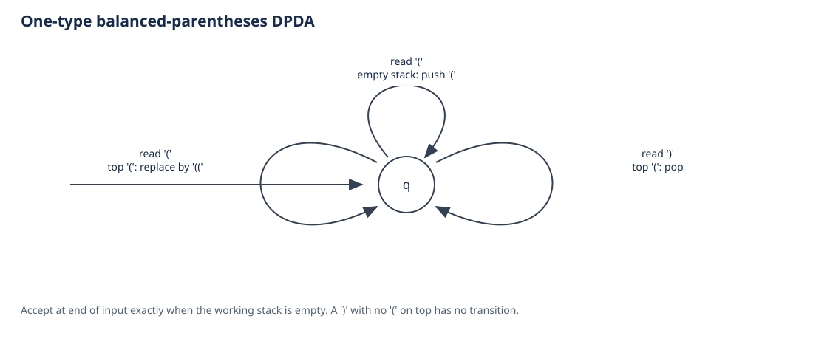
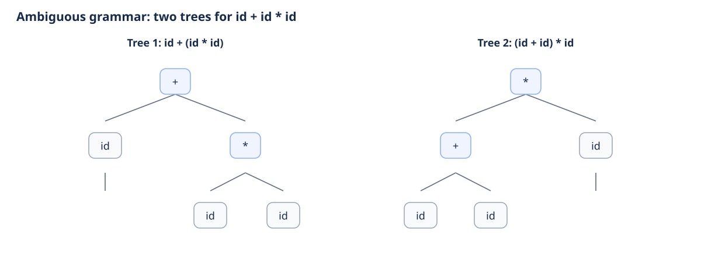
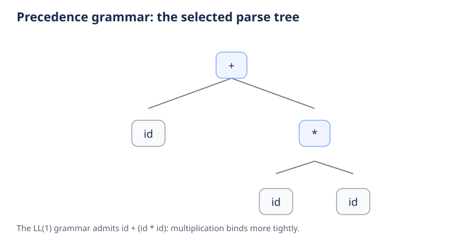
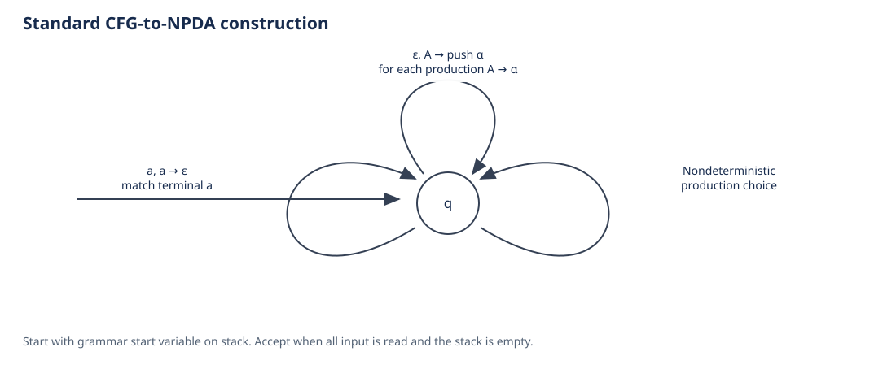
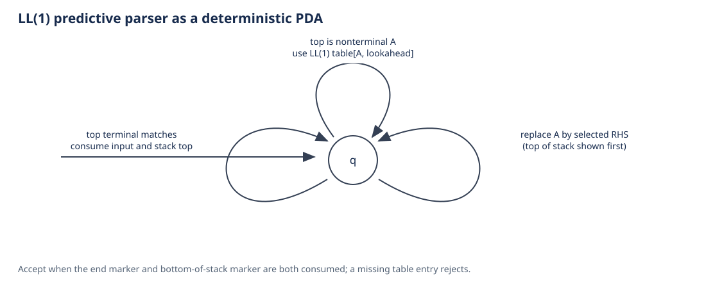
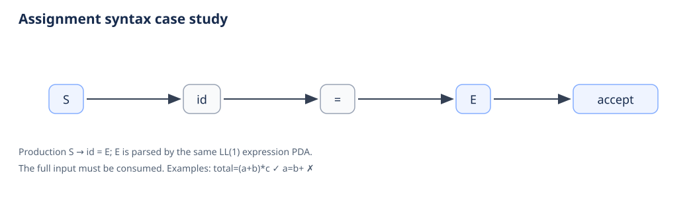

# Case Studies with Pushdown Automata and Context-Free Grammars

An individual Formal Language and Automata project with three original case studies. Each case defines a context-free grammar, explains its PDA model, and gives accepted and rejected examples. The project also demonstrates ambiguity, precedence, FIRST/FOLLOW analysis, and CFG-to-PDA construction.

## Case studies at a glance

| Case study | Grammar | PDA model | Determinism |
|---|---|---|---|
| Balanced parentheses | `S → ( S ) S \| ε` | One-state stack machine; push on `(`, pop on `)` | Deterministic; accepts by empty stack |
| Arithmetic expressions | Precedence grammar for `+`, `*`, grouping, and identifiers | General CFG-to-NPDA construction plus LL(1) predictive PDA | Generic construction may branch; predictive parser is deterministic |
| Assignment syntax | `S → id = E`, where `E` is the expression grammar | Predictive PDA reuses the expression parser after `id =` | Deterministic |

## Run it

Requires Python 3.10 or newer. The implementation has no third-party runtime dependencies.

```bash
python -m pda_cfg
python -m unittest discover -s tests -v
python tools/make_diagrams.py
```

The menu options are expression validation, assignment validation, balanced-parentheses validation, an ambiguity witness, a generic CFG-to-PDA run, FIRST/FOLLOW plus LL(1) analysis, and a list of grammars with accepted/rejected examples. The diagram command rebuilds the SVGs and the gallery in `docs/diagrams/`.

Open [`docs/index.html`](docs/index.html) for the interactive parser demo, or [`docs/diagrams/index.html`](docs/diagrams/index.html) for the static diagrams. The formal report and detailed stack traces are in [`docs/design.md`](docs/design.md).

## Why a finite automaton is not enough

Balanced parentheses require remembering how many opening brackets still need a matching close. The language contains strings `(`ⁿ`)`ⁿ for every `n ≥ 0`. If it were regular with pumping length `p`, consider `(`ᵖ`)`ᵖ. In any split `xyz` with `|xy| ≤ p` and `|y| > 0`, `y` contains only opening brackets. Pumping down removes some openings but leaves all `p` closing brackets, producing a string outside the language. That contradicts the pumping lemma. A PDA's stack supplies the unbounded memory a DFA lacks.

## 1. Balanced parentheses

The grammar is `S → ( S ) S | ε`. It generates exactly the strings over `{(, )}` in which every prefix has at least as many `(` as `)` and the totals are equal. For example:

```text
S ⇒ ( S ) S ⇒ () S ⇒ () ( S ) S ⇒ () () S ⇒ ()()
```

The DPDA uses one control state and an unbounded stack. On `(` it pushes a marker; on `)` it pops one marker if available. A close with an empty stack has no move. It accepts at end of input when the stack is empty.



Accepted examples: empty input, `()`, `(())`, `()()`, `(()())`. Rejected examples: `(`, `(()`, `)(`, `())`, `(a)`.

## 2. Arithmetic expressions

The unprioritized grammar below is ambiguous:

```text
E → E + E | E * E | ( E ) | id
```

The token string `id + id * id` has two parse trees, corresponding to `id + (id * id)` and `(id + id) * id`.



The parser uses a grammar that encodes precedence and associativity instead:

```text
E  → T E'
E' → + T E' | ε
T  → F T'
T' → * F T' | ε
F  → ( E ) | id
```

This LL(1) grammar gives `*` higher precedence than `+`; both operators associate left. FIRST/FOLLOW analysis builds the predictive table and reports no conflicts. The parser keeps pending grammar symbols on its stack and records every production expansion and terminal match.



The repository also constructs the standard one-state CFG-to-NPDA for comparison. That general construction chooses among productions nondeterministically; the LL(1) parser uses one lookahead token and selects a unique production.





## 3. Assignment syntax

The statement grammar is:

```text
S → id = E
```

`E` is the expression grammar above. The whole input must match the assignment production and contain one complete expression. `total=(a+b)*c` is accepted; `a=b+`, `=a+b`, and `a+b=c` are rejected.



## Syntax and semantics

These models recognize syntax under the listed grammars. They do not calculate arithmetic results, check variable declarations or types, or implement a full programming language. The assignment checker validates one restricted assignment statement; the parenthesis model handles one bracket type.

## Project layout

```text
pda_cfg/grammar.py      CFGs, FIRST/FOLLOW, and LL(1) table
pda_cfg/pda.py          general PDA engine and CFG-to-PDA conversion
pda_cfg/ll1.py          tokenizer and deterministic predictive parser
pda_cfg/cases.py        case descriptions and valid/invalid examples
pda_cfg/cli.py          interactive terminal menu
pda_cfg/                balanced.py, ambiguity.py, and package entry point
tests/                  standard-library parser and formal-model tests
tools/                  SVG and gallery generator with its HTML template
docs/design.md           report, derivations, traces, examples, and limits
docs/grammars.json       machine-readable CFG and PDA summary
docs/diagrams/           PDA transition diagrams and parse-tree figures
docs/index.html          standalone interactive demo
```

The implementation and diagrams are independently written for these three case studies; the example repository is used as a layout reference only.
