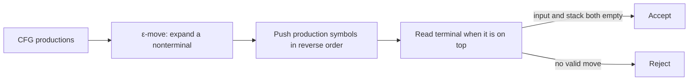
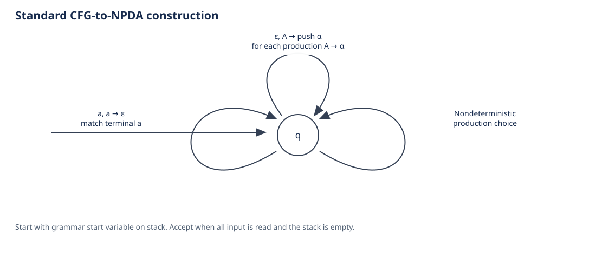
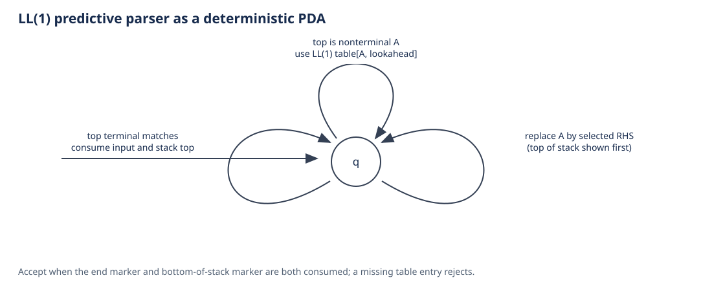
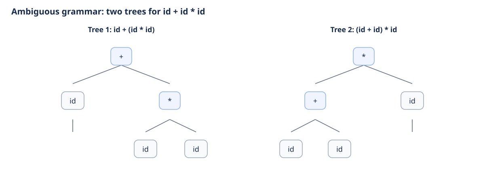
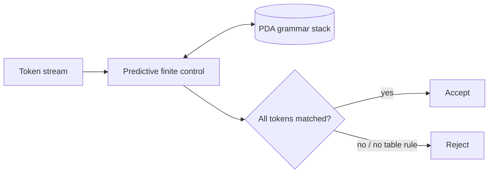
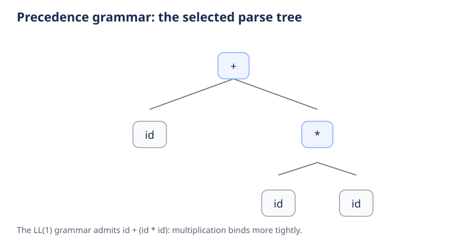
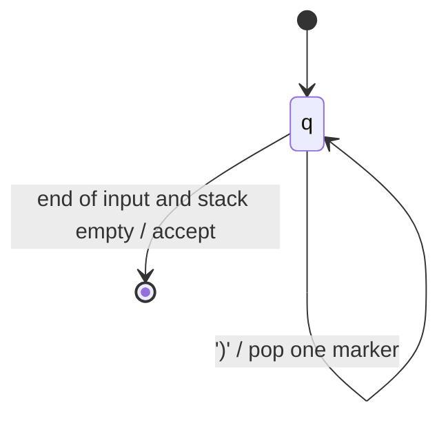
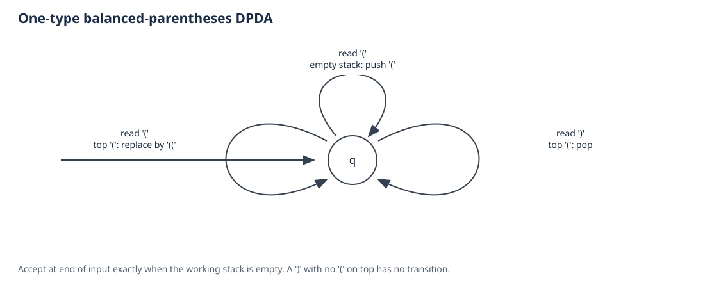

# Task 3 report content and formal design

## Title

**Case Study-Based Analysis and Design Using Context-Free Grammar and Pushdown Automata**

## Abstract

This project applies context-free grammars and pushdown automata to three syntax-recognition problems: arithmetic expressions, simple assignment statements, and balanced parentheses. A predictive parser uses an explicit stack to simulate a deterministic PDA for the LL(1) grammars. A separate stack recognizer demonstrates push/pop behavior for the one-type parenthesis language. The examples expose why unbounded nesting needs memory beyond a finite-state control. All results concern syntax and do not establish program meaning.

## Introduction and objectives

A CFG describes recursively structured strings. A PDA extends finite control with a stack, allowing it to remember nested structure. The objectives are to write precise grammars, demonstrate parsing and stack moves, handle malformed inputs, and explain the boundary between syntax and semantics.

Balanced parentheses are not regular. If the language had pumping length `p`, choose `w = (`ᵖ`)`ᵖ. For any decomposition `w = xyz` with `|xy| ≤ p` and `|y| > 0`, `y` contains only opening parentheses. Pumping down removes at least one opening parenthesis but leaves all `p` closing parentheses, so the result is not balanced. This contradicts the pumping lemma. The PDA stack supplies the unbounded memory that a finite automaton lacks.

## Grammar analysis and CFG-to-PDA construction

The project calculates FIRST and FOLLOW sets from the grammar rather than storing a hand-written parse table. For the expression grammar, the central results are:

| Nonterminal | FIRST | FOLLOW |
|---|---|---|
| `E` | `{ (, id }` | `{ ), $ }` |
| `Ep` | `{ +, ε }` | `{ ), $ }` |
| `T` | `{ (, id }` | `{ +, ), $ }` |
| `Tp` | `{ *, ε }` | `{ +, ), $ }` |
| `F` | `{ (, id }` | `{ *, +, ), $ }` |

The implementation constructs the LL(1) table using `FIRST(rhs)` and, when a production can derive ε, the `FOLLOW(lhs)` set. An occupied table cell with more than one production is reported as a conflict. No conflicts are found for this grammar. This confirms the predictive parser can select each production using one lookahead token.

For a grammar `G = (V, Σ, P, S)`, `cfg_to_pda` builds the standard one-state nondeterministic PDA. It begins with `S` on the stack. For each production `A → α`, it adds an ε-input transition that replaces stack-top `A` by `α`. For each terminal `a`, it adds a transition that consumes `a` when `a` is the stack top. It accepts by empty stack after all input is consumed.



The CFG-to-PDA machine is nondeterministic in general because a grammar can offer multiple productions for a nonterminal. The bounded breadth-first simulator stores each distinct `(control state, input position, stack)` configuration once, reconstructs an accepting path, and stops with an explicit limit result if the configured search bound is reached. The LL(1) parser is a separate deterministic PDA implementation that uses the computed predictive table.





## Case study 1: Arithmetic expression validation

Tokens `id` represent identifiers or decimal integer literals. The grammar is:

```text
E  → T E'
E' → + T E' | ε
T  → F T'
T' → * F T' | ε
F  → ( E ) | id
```

This grammar is LL(1), unambiguous for the selected operators, gives `*` higher precedence than `+`, and gives each operator left associativity. Its terminals are `{id, +, *, (, )}`. The parser's PDA keeps grammar symbols on its stack, expands a nonterminal using the predictive table, and matches terminals against input. It accepts when both input end marker and bottom stack marker are consumed.

For contrast, the grammar `E → E + E | E * E | ( E ) | id` is ambiguous. The string `id + id * id` has these two parse trees:

```text
        +                   *
       / \                 / \
     id   *               +  id
         / \             / \
       id  id           id id
```

The first groups as `id + (id * id)`; the second groups as `(id + id) * id`. The implemented precedence grammar admits only the first grouping for that unparenthesized input. The CLI's bounded ambiguity witness enumerates both trees using the ambiguous grammar, separate from the runtime parser.





Example derivation for `a+b*c` (leftmost): `E ⇒ T E' ⇒ F T' E' ⇒ id T' E' ⇒ id E' ⇒ id + T E' ⇒ id + F T' E' ⇒ id + id * F T' E' ⇒ id + id * id T' E' ⇒ id + id * id E' ⇒ id + id * id`.



## Case study 2: Restricted assignment syntax

```text
S → id = E
```

`E` is the expression grammar above. A statement such as `total=(a+b)*c` is accepted; an assignment prefix missing its right side is rejected. Identifiers have a conventional ASCII identifier form, and integer literals are allowed as expression atoms. This is a deliberately small syntax subset, not a full programming-language parser. The same predictive PDA begins at `S` and reuses the expression productions.


## Case study 3: Balanced parentheses

CFG: `S → ( S ) S | ε`. Language: `D = { w ∈ {(,)}* : every prefix has at least as many '(' as ')', and totals are equal }`.

The DPDA starts with an empty working stack and one control state. On `(` with an empty stack, it pushes `(`; on `(` with `(` at the top, it replaces that marker with two markers. On `)` with `(` at the top, it pops. A close with an empty stack or a symbol outside the alphabet has no transition. It accepts after all input is read if the working stack is empty.

| Input symbol | Stack top | Action | Outcome |
|---|---|---|---|
| `(` | empty stack | push `(` | continue |
| `(` | `(` | replace top marker with `((` | continue |
| `)` | `(` | pop | continue |
| `)` | empty stack | no move | reject |
| outside `{(,)}` | any | no move | reject |
| end of input | empty stack | accept | balanced |
| end of input | `(` | no move | reject |





## Example test cases

| Case study | Accepted (5) | Rejected (5) |
|---|---|---|
| Expressions | `a+b`, `a*b`, `(a+b)*c`, `x1 + 23 * y`, `a*(b+c)+d` | `a+`, `*ab`, `(a+b`, `a b`, `a++b` |
| Assignments | `a=b`, `a=b+c`, `x=y*z`, `total=(a+b)*c`, `result = value1 + 42` | `=a+b`, `a=b+`, `a==b`, `a+b=c`, `a=b; c=d` |
| Parentheses | empty string, `()`, `(())`, `()()`, `(()())` | `(`, `(()`, `)(`, `())`, `(a)` |

## PDA trace illustration

For `a+b`, after tokenization the input is `id + id $`. The predictive PDA records stack and remaining input after every production expansion or terminal match. Stack top is shown on the left:

| Action | Stack after action | Input remaining |
|---|---|---|
| start | `E $` | `id + id $` |
| `E → T E'` | `T E' $` | `id + id $` |
| `T → F T'` | `F T' E' $` | `id + id $` |
| `F → id` | `id T' E' $` | `id + id $` |
| match `id` | `T' E' $` | `+ id $` |
| `T' → ε` | `E' $` | `+ id $` |
| `E' → + T E'` | `+ T E' $` | `+ id $` |
| match `+` | `T E' $` | `id $` |
| `T → F T'`; `F → id` | `id T' E' $` | `id $` |
| match `id` | `T' E' $` | `$` |
| `T' → ε`; `E' → ε` | `$` | `$` |
| match `$` | empty | empty |

## Implementation, results, and limits

`pda_cfg/grammar.py` computes FIRST and FOLLOW sets, builds the LL(1) table, and reports conflicts. `pda_cfg/ll1.py` tokenizes and runs the deterministic predictive PDA while retaining instantaneous descriptions. `pda_cfg/pda.py` provides a general nondeterministic PDA simulator with breadth-first configuration exploration, accepting-path reconstruction, and a maximum-configuration bound. Its CFG-to-PDA constructor implements the standard one-state NPDA construction that accepts by empty stack; the CLI exposes the resulting stack computation and whether the transition relation is deterministic. The parentheses case is also represented as a DPDA in that engine. `pda_cfg/ambiguity.py` gives a bounded parse-tree witness for the ambiguous expression grammar. `pda_cfg/cases.py` keeps the three case summaries and sample strings used by the CLI. `docs/grammars.json` is the machine-readable grammar summary. Tests cover parser/model behavior and bounded balanced-parentheses agreement. Run `python tools/make_diagrams.py` to rebuild six SVG figures and the diagram gallery. Launch `python -m pda_cfg` for the CLI or open `docs/index.html` locally for the browser demo. Run the suite with `python -m unittest discover -s tests -v`. The grammar does not evaluate arithmetic, enforce type rules, declare variables, or support assignment lists, subtraction, division, unary operators, or function calls. The parenthesis checker recognizes one bracket type only. A successful parse means syntax recognition under the given grammar, not semantic correctness.

## Conclusion

The expression and assignment examples demonstrate grammar-driven parsing with a stack that stores pending structure. Balanced parentheses show directly how push and pop operations remember nesting depth. The separate models illustrate CFG/PDA applications while making their restricted language boundaries explicit.

## References

1. J. E. Hopcroft, R. Motwani, and J. D. Ullman, *Introduction to Automata Theory, Languages, and Computation*, 3rd ed., Pearson, 2006.
2. A. V. Aho, M. S. Lam, R. Sethi, and J. D. Ullman, *Compilers: Principles, Techniques, and Tools*, 2nd ed., Pearson, 2006.
3. Python Software Foundation, *Python 3 Documentation*, https://docs.python.org/3/.
