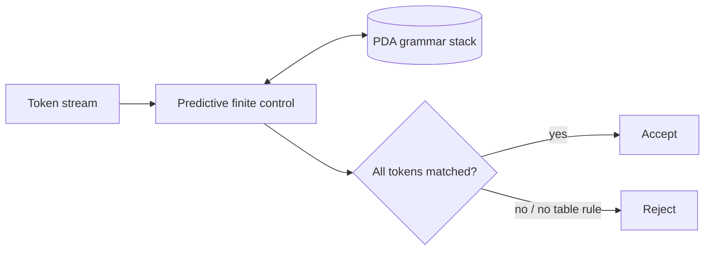
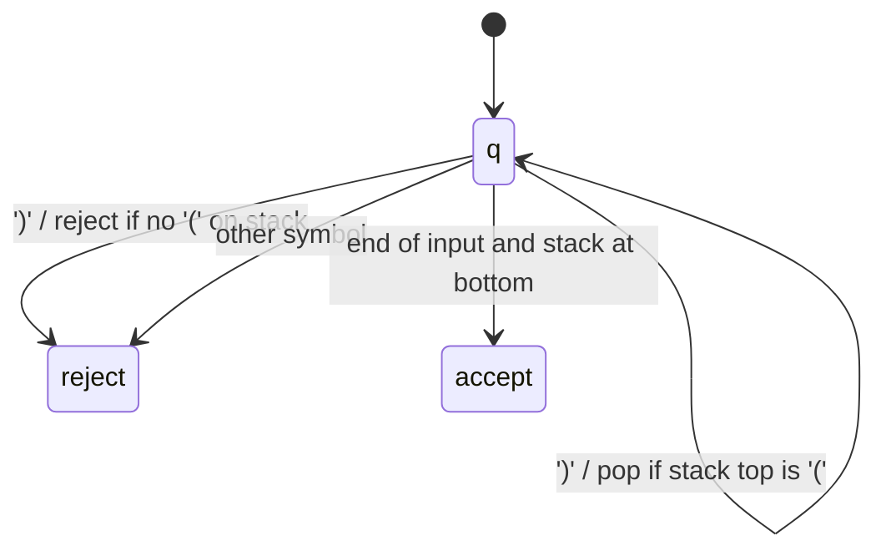

# Task 3 report content and formal design

## Title

**Case Study-Based Analysis and Design Using Context-Free Grammar and Pushdown Automata**

## Abstract

This project applies context-free grammars and pushdown automata to three syntax-recognition problems: arithmetic expressions, simple assignment statements, and balanced parentheses. A predictive parser uses an explicit stack to simulate a deterministic PDA for the LL(1) grammars. A separate stack recognizer demonstrates push/pop behavior for the one-type parenthesis language. The examples expose why unbounded nesting needs memory beyond a finite-state control. All results concern syntax and do not establish program meaning.

## Introduction and objectives

A CFG describes recursively structured strings. A PDA extends finite control with a stack, allowing it to remember nested structure. The objectives are to write precise grammars, demonstrate parsing and stack moves, handle malformed inputs, and explain the boundary between syntax and semantics.

## Case study 1: Arithmetic expression validation

Tokens `id` represent identifiers or decimal integer literals. The grammar is:

```text
E  → T E'
E' → + T E' | ε
T  → F T'
T' → * F T' | ε
F  → ( E ) | id
```

This grammar is LL(1), unambiguous for the selected operators, gives `*` higher precedence than `+`, and gives each operator left associativity. Its terminals are `{id, +, *, (, )}`. The parser's PDA keeps grammar symbols on its stack, expands a nonterminal using the predictive table, and matches terminals against input. It accepts when both input end marker and bottom stack marker are consumed.



Example derivation for `a+b*c` (leftmost): `E ⇒ T E' ⇒ F T' E' ⇒ id T' E' ⇒ id E' ⇒ id + T E' ⇒ id + F T' E' ⇒ id + id * F T' E' ⇒ id + id * id T' E' ⇒ id + id * id E' ⇒ id + id * id`.

## Case study 2: Restricted assignment syntax

```text
S → id = E
```

`E` is the expression grammar above. A statement such as `total=(a+b)*c` is accepted; an assignment prefix missing its right side is rejected. Identifiers have a conventional ASCII identifier form, and integer literals are allowed as expression atoms. This is a deliberately small syntax subset, not a full programming-language parser. The same predictive PDA begins at `S` and reuses the expression productions.

## Case study 3: Balanced parentheses

CFG: `S → ( S ) S | ε`. Language: `D = { w ∈ {(,)}* : every prefix has at least as many '(' as ')', and totals are equal }`.

The DPDA has a bottom marker and one stack marker `(`. It pushes for every opening parenthesis, pops for each closing parenthesis, rejects on a close at bottom or on a symbol outside the alphabet, and accepts at end if only the bottom marker remains. An unbounded stack is necessary because this language is not regular.

| Input symbol | Stack top | Action | Outcome |
|---|---|---|---|
| `(` | bottom marker or `(` | push `(` | continue |
| `)` | `(` | pop | continue |
| `)` | bottom marker | no move | reject |
| outside `{(,)}` | any | no move | reject |
| end of input | bottom marker | accept | balanced |
| end of input | `(` | no move | reject |



## Example test cases

| Case study | Accepted (5) | Rejected (5) |
|---|---|---|
| Expressions | `a+b`, `a*b`, `(a+b)*c`, `x1 + 23 * y`, `a*(b+c)+d` | `a+`, `*ab`, `(a+b`, `a b`, `a++b` |
| Assignments | `a=b`, `a=b+c`, `x=y*z`, `total=(a+b)*c`, `result = value1 + 42` | `=a+b`, `a=b+`, `a==b`, `a+b=c`, `a=b; c=d` |
| Parentheses | empty string, `()`, `(())`, `()()`, `(()())` | `(`, `(()`, `)(`, `())`, `(a)` |

## PDA trace illustration

For `a+b`, after tokenization the input is `id + id $`. One possible predictive stack trace, with top shown on the left:

| Stack action | Input remaining |
|---|---|
| expand `E → T E'` | `id + id $` |
| expand `T → F T'` | `id + id $` |
| expand `F → id` | `id + id $` |
| match `id`; expand `T' → ε` | `+ id $` |
| expand `E' → + T E'`; match `+` | `id $` |
| expand `T → F T'`; expand `F → id`; match `id` | `$` |
| expand `T' → ε`, `E' → ε`; match `$` | empty |

## Implementation, results, and limits

`task3/parser.py` tokenizes and runs the predictive PDA stack; `task3/balanced.py` records each push/pop. Run `python -m task3`; tests are under `tests/` and run with `python -m unittest discover -s tests -v`. The grammar does not evaluate arithmetic, enforce type rules, declare variables, or support assignment lists, subtraction, division, unary operators, or function calls. The parenthesis checker recognizes one bracket type only. A successful parse means syntax recognition under the given grammar, not semantic correctness.

## Conclusion

The expression and assignment examples demonstrate grammar-driven parsing with a stack that stores pending structure. Balanced parentheses show directly how push and pop operations remember nesting depth. The separate models illustrate CFG/PDA applications while making their restricted language boundaries explicit.

## References

1. J. E. Hopcroft, R. Motwani, and J. D. Ullman, *Introduction to Automata Theory, Languages, and Computation*, 3rd ed., Pearson, 2006.
2. A. V. Aho, M. S. Lam, R. Sethi, and J. D. Ullman, *Compilers: Principles, Techniques, and Tools*, 2nd ed., Pearson, 2006.
3. Python Software Foundation, *Python 3 Documentation*, https://docs.python.org/3/.
